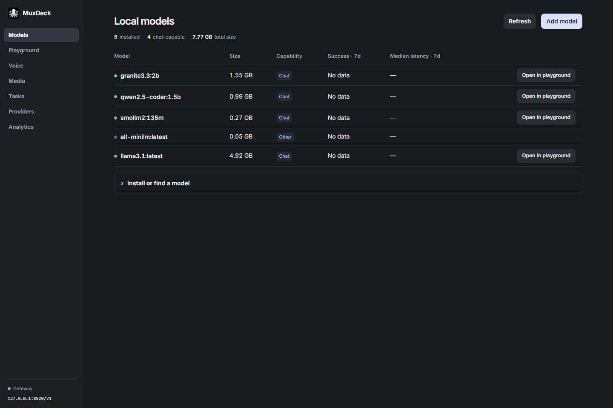
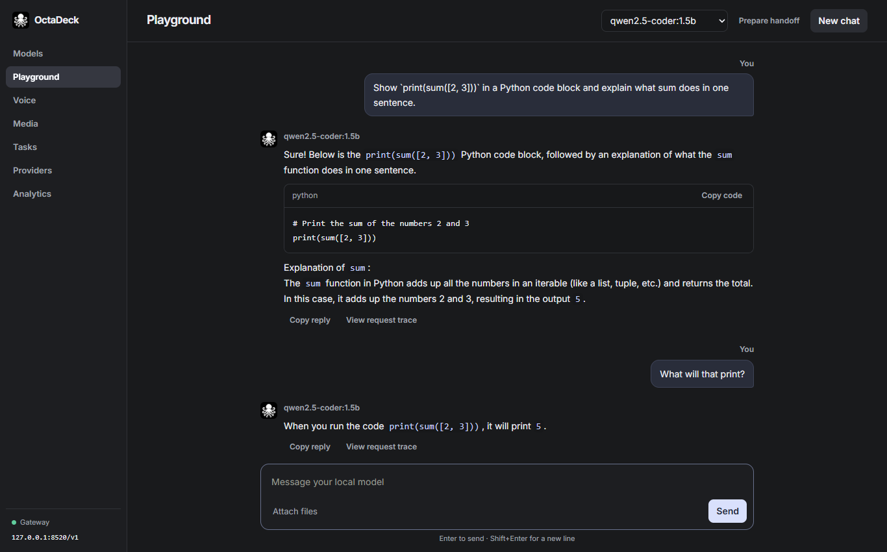
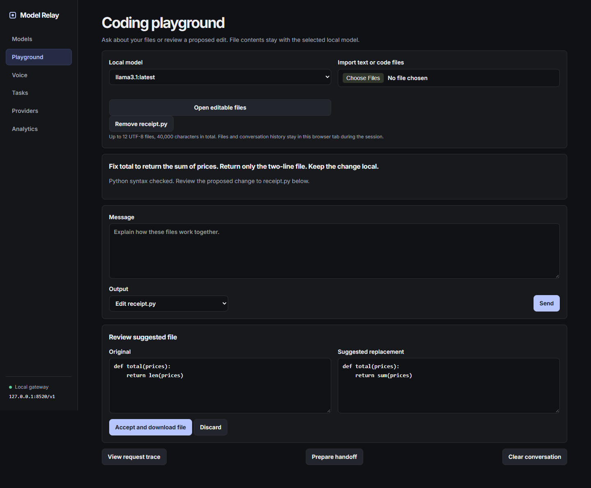
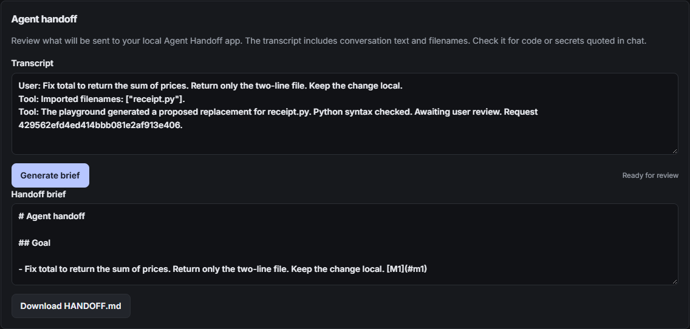
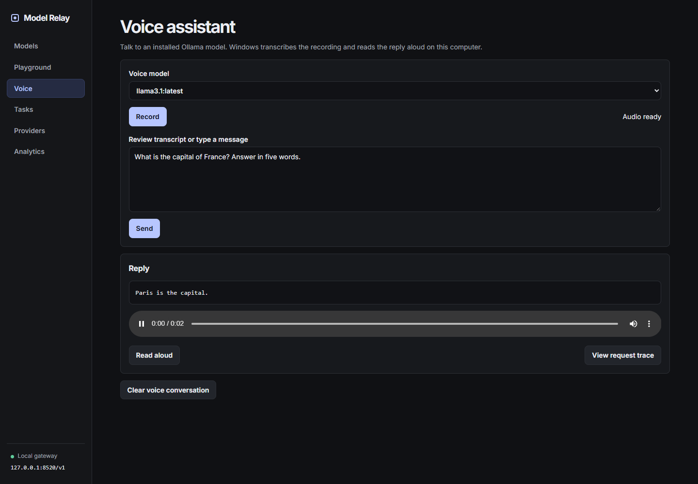
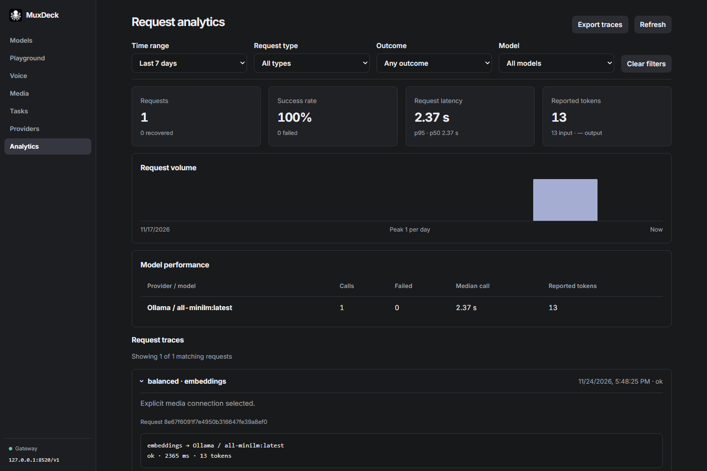
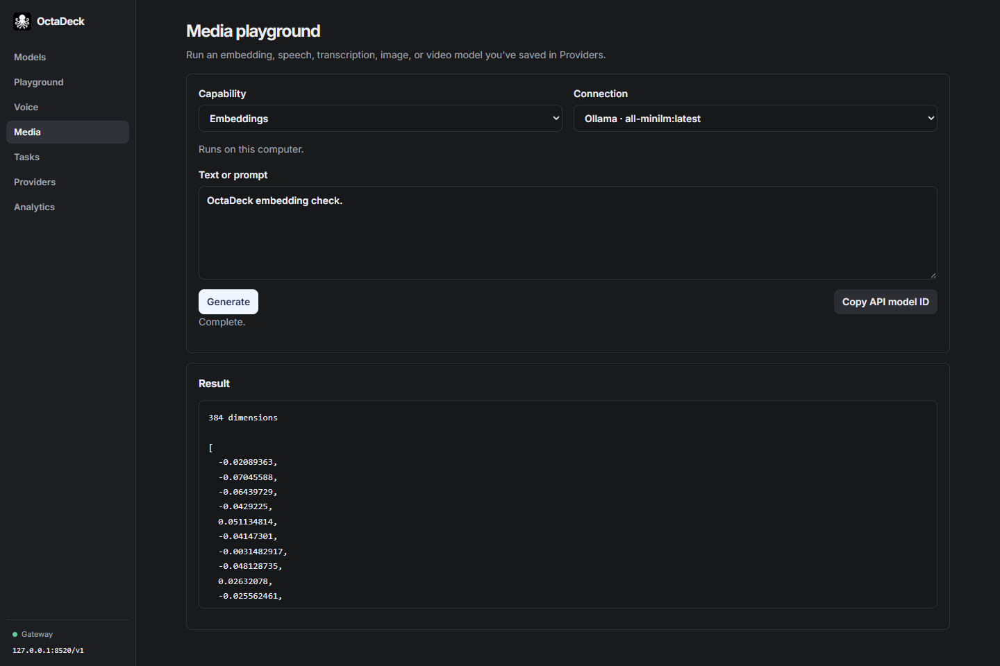
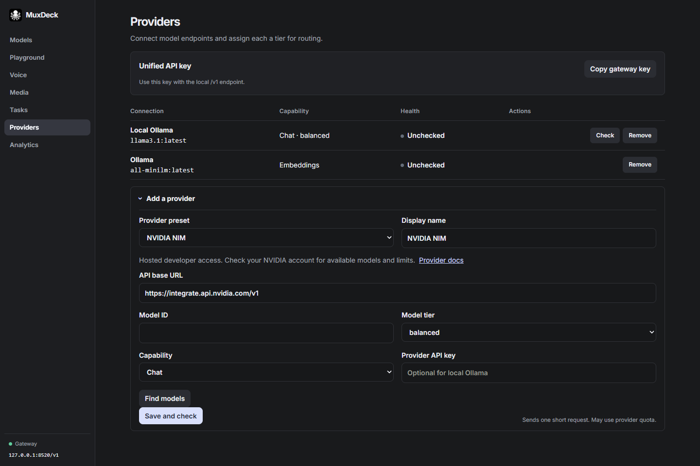
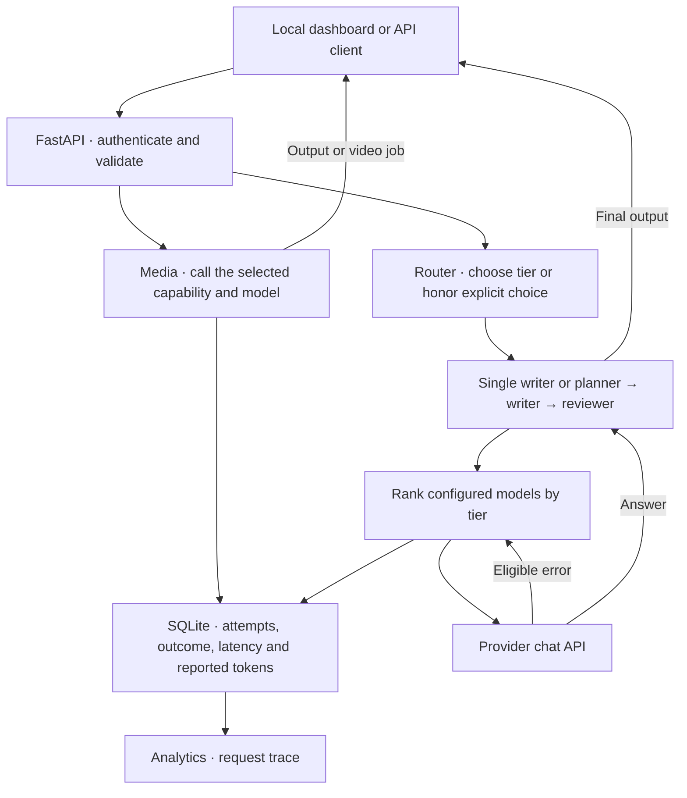

# OctaDeck

A local model gateway for people who use several LLM APIs. Connect provider models, give your apps one bearer key, and inspect the route each request took. The Tasks tab also runs a bounded planning and review workflow for demanding text requests.

[Visit the OctaDeck website](https://sanjeeth-prakash.github.io/OctaDeck/) · [Download OctaDeck for Windows](https://github.com/Sanjeeth-Prakash/OctaDeck/releases/latest)

The dashboard keeps Models, Playground, Voice, Media, Tasks, Providers, and Analytics in a sidebar on desktop and compact navigation on smaller screens. The Models and Providers tables surface local usage and connection health.

The website includes an app preview, a PowerShell API example, and installer links. See the [landing-page source and local preview instructions](website/README.md).

## Local model studio

With OctaDeck running, `python smoke_playground.py llama3.1:latest qwen2.5-coder:1.5b granite3.3:2b` checks live chat, a Python edit with a known expected result, syntax validation, and request IDs. Install the listed models through **Add model** first. This is a focused compatibility check, and its result is specific to the sample task and the installed model versions.

Qwen2.5-Coder is the initial Playground selection when installed. You can switch models at any time. The 135M SmolLM2 model completed the chat request, then produced invalid Python on both tries of the same coding fixture. OctaDeck blocked the replacement and recorded both failed checks.

Live compatibility checks passed on Llama 3.1, Qwen2.5-Coder 1.5B, and Granite 3.3 2B for the sample Python edit. Chrome also verified file import, approval, download, and opening the corresponding trace for both new models. An on-disk apply was verified using a browser test filesystem handle.

**Models** lists installed Ollama models and offers one-click installation, progress and retry. Start Ollama first. Select a starter, enter a registry tag, or search public Hugging Face GGUF text models and inspect their model cards. For a particular quantization enter `hf.co/owner/repository:Q4_K_M`. Downloads can be large. The runtime must support the model architecture; a repository appearing in search does not guarantee that it fits your hardware. A completed local chat install joins the gateway pool automatically.



The inventory shows each local model's last seven days of recorded model calls, including success rate and median call latency. The dotted indicator represents the observed success rate. Models without calls display **No data**. The interface bundles the Latin Inter variable font under the [SIL Open Font License](assets/Inter-OFL.txt).

**Playground** is a session chat with a pinned local model. Press **Enter** to send or **Shift+Enter** for a new line. You can copy fenced code or open a request trace from the reply that produced it. Use **New chat** to clear the conversation.



Use **Attach files** to add UTF-8 source files, up to 12 files and 40,000 characters in total. Select a file under **Output** to ask for a complete replacement. Python and JSON proposals receive a syntax check and one repair attempt if needed. Review the original and the suggestion, edit the result, and download it. On supported browsers, **Open editable files** also lets you save an approved replacement to its original file after checking for changes on disk. The playground works with text and reviewed file edits. Run project commands and tests separately.

The playground server owns the assistant instructions and treats imported text as untrusted context. It validates the proposed file and checks the reviewed version again before saving or downloading. The request trace shows generation, validation, and any repair attempt. These checks cover completeness signals, size, text format, and Python or JSON syntax. Review behavior and run your project's tests separately.



### Hand off a playground session

Run the separate ThreadBrief app on port 8512 with Ollama and Llama 3.1. In the Playground, make a request, select **Prepare handoff**, and review the proposed transcript. It includes recent turns, imported filenames, and recorded actions such as a syntax check, a discarded draft, or a save. OctaDeck omits raw file attachments and generated replacements from the transcript. Review chat excerpts for pasted or quoted code before generating. [ThreadBrief on GitHub](https://github.com/Sanjeeth-Prakash/ThreadBrief)

**Generate brief** calls Agent Handoff over loopback. Its model selects evidence for the goal, verified state, next step, and constraints. Click **Download HANDOFF.md** after reviewing the editable brief. The next agent can open that file as context.



To call an installed model from another local text client, set its API base to `http://127.0.0.1:8520/v1`, copy the bearer key under **Providers**, and choose a model such as `local/llama3.1:latest` from `GET /v1/models`. This pins the request to Ollama even if cloud keys are configured. Use `auto` to allow cross-provider routing. The endpoint currently supports non-streaming text completions. Loopback points to the device running the caller; this setup is intended for same-machine clients.

### Model files

Ollama manages the model weights. Windows uses the directory configured in `OLLAMA_MODELS`, or `%USERPROFILE%\.ollama\models` with the default setup. OctaDeck uses `OCTADECK_HOME` for its settings, keys, and request metadata. It also accepts the earlier `MUXDECK_HOME` and `MODEL_RELAY_HOME` variables. When neither is set, it uses the project's gitignored `.data` directory.

### Voice assistant

Open **Voice**, select an installed model, and record one short phrase. Review the transcript, choose **Send**, and click **Read aloud**. You can also type a message. The browser captures audio, Windows desktop speech transcribes and synthesizes it, and the pinned Ollama model generates the reply. Microphone access requires browser permission. Windows must have a compatible recognizer and voice installed. Conversation history stays in the current tab and analytics tracks the local model call.



### Nearby products

- [LM Studio](https://lmstudio.ai/docs/app) combines model downloads, a local API and coding integrations.
- [Open WebUI](https://docs.openwebui.com/getting-started/quick-start/connect-a-provider/starting-with-ollama/) manages Ollama downloads and connects to local and hosted models.
- [FreeLLMAPI](https://github.com/tashfeenahmed/freellmapi) combines provider credentials, routing, a playground and analytics.

The product hypothesis to test is whether users can go from finding a local model to reviewing a first code edit and identifying its exact model, attempts and token use in one session. The features individually already exist.



## Windows desktop app

Download **OctaDeck-Setup-x64.exe** from the latest Windows release, choose an installation directory, and open **OctaDeck.lnk**. When upgrading, select the existing application folder to keep its providers, settings, and analytics. The unsigned setup bundles Python and the app. Windows supplies WebView2 and .NET Framework. Cloud connections work directly with provider keys. Install Ollama separately if you want to run and download models locally. [Latest Windows release](https://github.com/Sanjeeth-Prakash/OctaDeck/releases/latest)

Archived releases used the earlier Model Relay and MuxDeck names. The file review, Voice, and handoff screenshots show earlier Windows builds. [Release archive](https://github.com/Sanjeeth-Prakash/OctaDeck/releases)

To build the same type of installer from source, run `python build-release.py --output <build-directory>` on x64 Windows with Python, pip and .NET Framework available.

### Run a desktop build from source

On x64 Windows with Python 3.11+, .NET Framework and Microsoft Edge WebView2 Runtime, run the installer from this project folder.

```powershell
.\install-desktop.ps1 -InstallRoot 'G:\softwares\Models\OctaDeck'
```

Open **OctaDeck.lnk** in that folder. The shortcut opens a native window with the existing Windows WebView2 runtime. The install directory holds the launcher, Python dependencies, app data, downloads, and browser profile. The app uses port 8520. When the window starts its own gateway, closing it stops the gateway. A gateway you started separately can be used with the browser or external clients. The launcher depends on the project source folder passed by the shortcut.

On this PC, one idle measurement shortly after opening Models showed **231.5 MiB of private committed memory** for the desktop window, WebView2, and gateway process tree combined. The Python gateway processes accounted for **42.8 MiB** of that total. These are workstation snapshots. Resident working set and memory while generating a response can vary. Ollama and loaded model weights run in separate processes.

## Run the gateway in a browser

Use Python 3.11 or newer. From this project folder in PowerShell:

```powershell
python -m venv .venv
.\.venv\Scripts\python.exe -m pip install -r requirements.txt
.\.venv\Scripts\python.exe -m uvicorn app:app --host 127.0.0.1 --port 8520
```

Open **http://127.0.0.1:8520**. The first launch adds a local Ollama model named `llama3.1:latest`. To use it, start Ollama with that model installed. Under **Providers**, choose **Add a provider** to connect NVIDIA NIM, Gemini, Groq, OpenRouter, Cerebras, Mistral, Hugging Face, Cloudflare Workers AI, OpenCode Zen, Cohere, SiliconFlow, or Ollama. **Custom** accepts another compatible base URL. Enter a key and select **Find models** for providers that offer model discovery, or enter the exact model ID manually. Each preset links to provider documentation.

Plans may be free, trial, metered, or restricted to certain models. For OpenRouter chat, discovery marks explicit `:free` and `openrouter/free` aliases. Text, image, video, and speech limits can use different units. **Reported tokens** in Analytics are usage from responses to OctaDeck, not an estimate of your remaining provider allowance.

In **Tasks**, try “Say hello in Swedish.” Then try “Describe the tradeoffs between local and hosted inference.” Open **View request trace** to see the difference. A request can send its text and intermediate outputs to any configured fallback provider. Paid providers can bill for each attempt.

### Provider health

Saving a chat model sends one small request to the configured model. **Check** repeats that probe with the stored credential. The table shows its most recent outcome, HTTP status, elapsed time and timestamp. Explicitly rejected, denied or missing connections are skipped in automatic routing until a new check clears the status. Recent timeouts and rate limits deprioritize a connection for five minutes. Checks may consume quota and stay separate from inference analytics. Media connections start unchecked and run only when you generate.

### Media playground

Choose a capability when saving a provider model, then select that connection in **Media**. For example, add Ollama with capability **Embeddings** and the installed model ID `all-minilm:latest`. Enter a sentence to see its vector and dimension count. Speech and transcription support provider-specific voices and formats. Image generation handles a base64 image or HTTPS result URL. OpenRouter video uses a job ID, status polling, and a download after completion. Hosted requests can spend provider credits.



For an API client, copy the `media/<id>` model ID from **Media** or obtain it from `GET /v1/models`. Use the same gateway bearer key.

| Capability | API request | Inputs and result |
|---|---|---|
| Embeddings | `POST /v1/embeddings` | `model`, `input`; JSON vectors |
| Speech | `POST /v1/audio/speech` | `model`, `input`, `voice`, optional `response_format`; MP3 or WAV |
| Transcription | `POST /v1/audio/transcriptions` | `model`, `input_audio` with base64 `data` and a `format`; JSON transcript |
| Image | `POST /v1/images/generations` | `model`, `prompt`, optional `size`; image JSON |
| Video | `POST /v1/videos` | `model`, `prompt`, optional `duration` and `aspect_ratio`; OpenRouter job ID |

Video status is at `GET /v1/videos/{id}`; retrieve its first output at `GET /v1/videos/{id}/content`. The gateway keeps a local job mapping for 30 days. The provider controls output retention. Media calls use the chosen model without automatic cross-model fallback. This keeps embedding dimensions stable and avoids duplicating paid media submissions. Media responses are capped at 24 MiB. [OpenRouter media endpoints](https://openrouter.ai/blog/insights/every-modality-one-api/) · [Video job lifecycle](https://openrouter.ai/docs/guides/overview/multimodal/video-generation)



## One API for callers

Copy the unified key from **Providers → Copy gateway key**. Example for PowerShell:

```powershell
$relayKey = (Get-Clipboard).Trim()
$payload = @{
    model = "auto"
    messages = @(@{role = "user"; content = "Explain model routing in one sentence."})
} | ConvertTo-Json -Depth 5
Invoke-RestMethod -Method Post -Uri http://127.0.0.1:8520/v1/chat/completions -Headers @{Authorization = "Bearer $relayKey"} -ContentType application/json -Body $payload
```

Use `GET /v1/models` to list virtual model names. `auto` applies the routing rule; `fast`, `balanced`, and `strong` explicitly request a tier. `POST /v1/chat/completions` makes one logical text completion. `POST /v1/tasks` enables the agent workflow. Both accept text messages, optional temperature and max_tokens, and return the final chat completion with an X-Request-ID header. These two routes return non-streaming text. The roles are inference calls with distinct instructions; they do not execute tools or take external actions.

## Architecture



**app.py** owns the two API surfaces: a loopback, same-origin management dashboard and a bearer-authenticated inference API. **routing.py** selects the preferred tier using prompt length and reasoning cues, then chooses up to three configured providers for each stage. Equally suitable providers follow configuration order. A stronger tier wins ties between adjacent tiers. These are explainable heuristics, not measured model intelligence. A strong task makes three calls even if only one model is installed.

**storage.py** stores provider credentials encrypted with Fernet and saves the vault key, gateway key and SQLite file in the configured data directory. Protect this directory as a unit. Anyone with access to the vault key and database can recover provider credentials. This version is single-owner software for a trusted local computer. A public shared deployment would require account isolation, admin authentication and per-user limits.

**Analytics** reports activity for the last 24 hours, 7 days, 30 days or 90 days. SQLite aggregates the full filtered period, including request volume, success and recovery, nearest-rank p50 and p95 request latency, provider call performance, and reported input/output tokens. Historical calls may only have a total token count. Filter by request type, outcome, or model. A model filter keeps all steps of a matching request so you can follow fallback. Local syntax checks appear in traces.

Open a trace to see why the router picked a tier and where a provider call or file check failed. The trace view and **Export traces** contain up to 100 matching requests. CSV has one row per step, plus one row for any request with no recorded steps. The database and export contain operational metadata. Prompts, outputs, provider keys, and raw upstream error bodies are excluded.

## Reference and verification

I studied the upstream routing, provider adapter and analytics structure, then implemented this independent Python application. FreeLLMAPI already provides a unified key, multi-provider routing, failover and analytics. OctaDeck explores when one text request should expand into multiple model roles and how the user can see the reason and outcome. [FreeLLMAPI router](https://github.com/tashfeenahmed/freellmapi/blob/7619c8fee886eeba8f28c84d5fc943f4459c1fbc/server/src/services/router.ts) · [Provider adapter](https://github.com/tashfeenahmed/freellmapi/blob/7619c8fee886eeba8f28c84d5fc943f4459c1fbc/server/src/providers/openai-compat.ts) · [Analytics](https://github.com/tashfeenahmed/freellmapi/blob/7619c8fee886eeba8f28c84d5fc943f4459c1fbc/server/src/routes/analytics.ts)

Run the tests with `.\.venv\Scripts\python.exe -m unittest -v`. The current suite has 23 tests covering authentication, saved credentials, retry after HTTP 429, request classification, agent stage order, model discovery, media routes, and video job polling. Local Ollama chat and embeddings and public OpenRouter model discovery were verified live. NVIDIA inference and hosted media generation were checked with fixtures. The effect of agent review on answer quality remains unmeasured.
