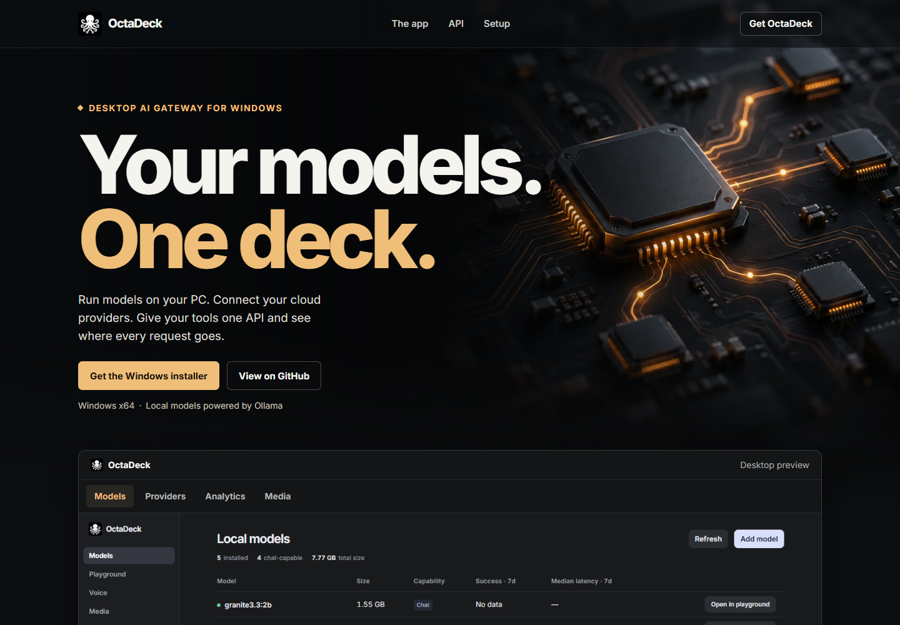

# OctaDeck landing page

The static site in `dist/` contains all its assets and needs no Node dependencies or build step.



From this directory, start a loopback preview:

```powershell
python -m http.server 8530 --bind 127.0.0.1 --directory dist
```

Open http://127.0.0.1:8530. The Windows button links to the current OctaDeck release. To offer a local build instead, serve a copy of `dist/` with the executable at `downloads/OctaDeck-Setup-x64.exe` in that copy. The loopback page detects that file and uses it as the download. The demo copy and installer can stay outside Git. [Latest Windows release](https://github.com/Sanjeeth-Prakash/OctaDeck/releases/latest)

The screenshot tabs show the installed app. The PowerShell example uses the local gateway on port 8520 and needs a gateway key from your own running instance. The landing page itself can be served by any static host.

The [model-routing backdrop](dist/assets/model-routing.webp) was made with built-in image generation and compressed to WebP.

<details>
<summary>Backdrop prompt</summary>

> Create a wide 16:9 cinematic landing-page backdrop for OctaDeck, a desktop LLM gateway. A compact graphite AI processor routes packets along fine amber-lit circuit paths to smaller model nodes on a dark motherboard. Render a believable macro product photograph with subtle copper traces and charcoal-blue metal. Place all bright detail in the right half, with the processor centered at roughly 73% width and 40% height. Leave the left 55% nearly black, quiet, and spacious for white website copy. Let the lower edge fade into black. Keep the image restrained and crisp, with only a handful of warm highlights. No text, logos, people, or maritime imagery.

</details>

The [OctaDeck octopus logo](../assets/octadeck-mark.png) uses the same white pixel artwork on the landing page and in the dashboard. Its [Windows icon](../assets/octadeck.ico) includes sizes for the shortcut, taskbar, and installer. The artwork was created with built-in image generation.

<details>
<summary>Logo prompt</summary>

> One original square logo icon for MuxDeck, inspired by small retro nautical octopus emblems. A clearly recognizable white OCTOPUS, not a skull: a smooth stepped bulbous octopus mantle, two small dark eyes, and eight short curling tentacles fanned symmetrically to either side and below. Negative space between arms is bold and clean. Tentacle ends curl back in simple square hooks, with two tips ending in small blocky squares like data connectors. Head is about a third of the height, limbs fill the lower two thirds. Use a single compact silhouette centered within a solid pure black square, comfortable even padding about 11 percent. White graphic only plus black background and black cutouts. Hard square stair steps on a coarse 32 by 32 conceptual pixel grid. Looks hand-pixeled using nearest-neighbor, no anti-aliasing, no gradients, no shading, no texture, no outline, no extra decorations. Highly legible 24px software logo. No text, no lettering, no border, no tricorn hat, no skull, no crossbones, no other icon, no mockup.

</details>
